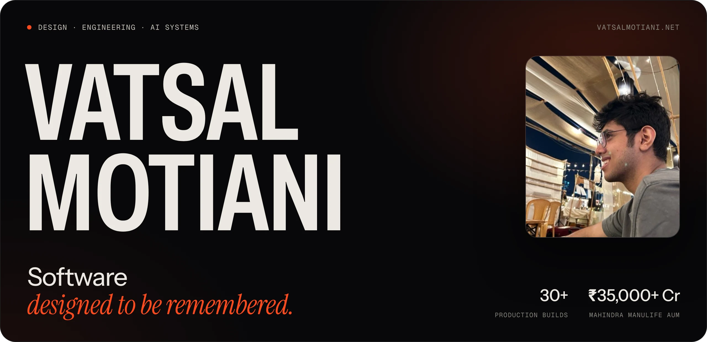
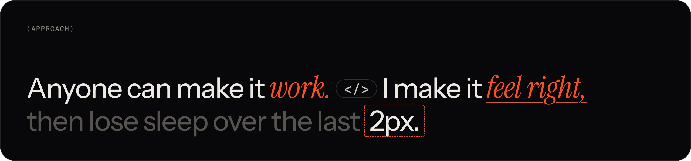
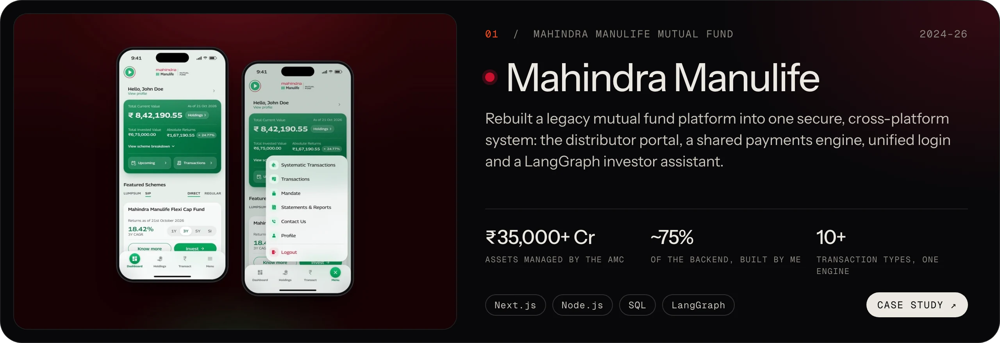
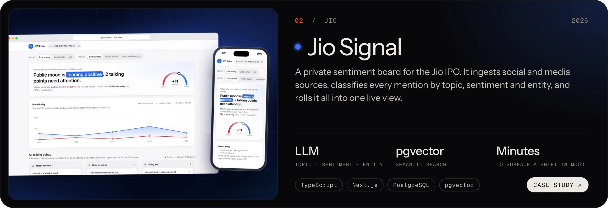
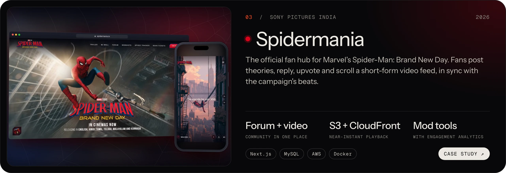
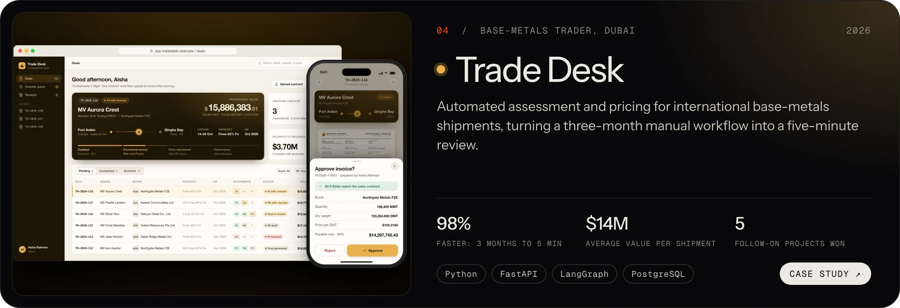
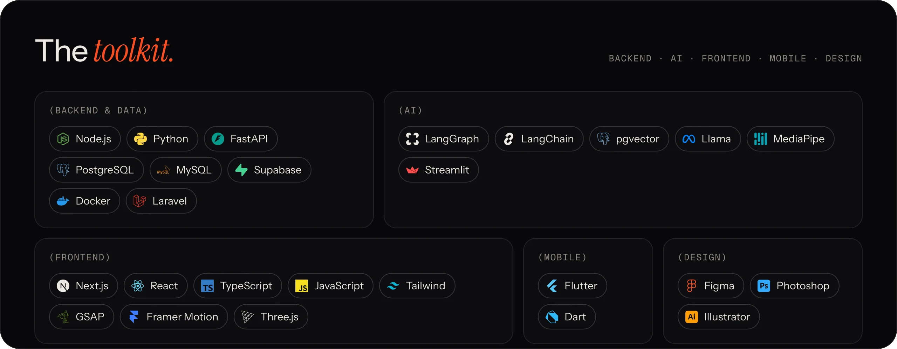
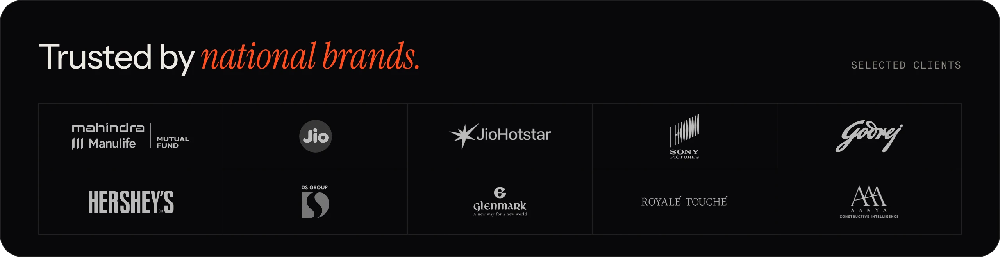

  <a href="https://vatsalmotiani.net"><b>vatsalmotiani.net</b></a>
  &nbsp;·&nbsp;
  <a href="https://linkedin.com/in/vatsalmotiani">LinkedIn</a>
  &nbsp;·&nbsp;
  <a href="mailto:vmmworking@gmail.com">vmmworking@gmail.com</a>

 

  

I build fintech platforms, automation systems and AI products, end to end: system design, backend, interface and the details in between. 30+ production builds for national brands so far.

 

## Selected work

<b>More work</b>

 

| | |
| --- | --- |
| [**Influ-Finder**](https://vatsalmotiani.net/work/influ-finder) | Multi-agent influencer marketing: discovery, evaluation, pitching and outreach |
| [**Clarify**](https://vatsalmotiani.net/work/clarify) | Upload a contract and get the red flags before you sign |
| [**AR Try-On**](https://vatsalmotiani.net/work/ar-experiences) | Browser AR campaigns for Hershey's, Godrej and DS Group |
| [**Paperless**](https://vatsalmotiani.net/work/paperless) | Any PDF, rebuilt as a book you can actually read on a phone |
| [**Tones**](https://vatsalmotiani.net/work/tones) | A camera that pulls and names the five dominant colours of any scene |
| [**Blogify**](https://vatsalmotiani.net/work/blogify) | YouTube video to finished blog post, in the language you choose |

 

  

  

  Every project has a full case study at <a href="https://vatsalmotiani.net">vatsalmotiani.net</a>. Say hi at <a href="mailto:vmmworking@gmail.com">vmmworking@gmail.com</a>.

